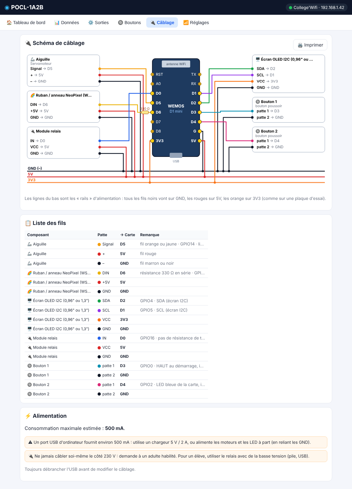

# POCL — firmware générique pour Wemos D1 mini (ESP8266) et ESP32-WROOM

Un seul firmware pour tous les POCL, sur **Wemos D1 mini**, carte **ESP32 DevKit (module WROOM-32)**, **ESP32-C3 Super Mini** ou **ESP32-S2 Mini** (LOLIN / Wemos) : l'objet récupère des **données ouvertes** (catalogue prêt à l'emploi : météo, qualité de l'air, pollens, rivières, mer, électricité, carburants, séismes… ; portails Opendatasoft français — Bordeaux, Paris, Rennes, Toulouse, Nantes, RTE… — ; n'importe quelle API JSON ; ou un potentiomètre) et les traduit en **mouvements, lumières, sons, textes ou messages MQTT** (servo, moteur pas à pas, relais, NeoPixel, écran OLED ou Nokia 5110, LED, buzzer, envoi MQTT).

Tout se règle depuis une **page web hébergée par l'ESP8266**, sans programmer :

| Onglet | Rôle |
|---|---|
| 🏠 Tableau de bord | valeurs en direct, état des sorties et des boutons, simulation d'une donnée |
| 📊 Données | catalogue de données prêtes, assistant de recherche Open Data, sélection d'une valeur JSON en un clic, A0, valeur manuelle |
| ⚙️ Sorties | choix du composant, des broches (avec schéma), de la courbe de réglage, essai en direct |
| 🔘 Boutons | boutons câblés et leur action |
| 🔌 Câblage | schéma complet généré automatiquement, liste des fils, bilan d'alimentation, impression |
| 📶 Réglages | WiFi, point d'accès, veille de nuit, recettes (export/import/exemples), mise à jour du firmware |



Autres captures : [catalogue de données](docs/catalogue.png) · [envoi MQTT](docs/mqtt.png) · [assistant Open Data](docs/assistant-open-data.png) · [éditeur d'écran OLED](docs/ecran-oled.png) · [tableau de bord](docs/tableau-de-bord.png)

---

## 1. Installer le firmware : `flash.sh`

Brancher la carte en USB, puis :
```bash
./flash.sh
```
Le script fait tout : il installe `arduino-cli`, le core de la carte et les bibliothèques (une seule fois, dans `~/.cache/pocl-arduino`, sans toucher à votre installation Arduino habituelle), trouve le port série, **reconnaît la carte (ESP8266, ESP32, ESP32-C3 ou ESP32-S2)**, compile, flashe, puis affiche le nom du WiFi de configuration de la carte (`POCL-XXXX`).

| Commande | Effet |
|---|---|
| `./flash.sh esp32` / `esp8266` / `esp32c3` / `esp32s2` | force le type de carte (`esp32c3` = Super Mini, `esp32s2` = S2 Mini) |
| `./flash.sh -p /dev/ttyUSB1` | choisit le port série |
| `./flash.sh --efface` | efface toute la mémoire avant (WiFi et recette compris) |
| `./flash.sh --moniteur` | ouvre le moniteur série après le flash |
| `./flash.sh --compile` | compile seulement les deux versions, binaires dans `bin/` |
| `./flash.sh --bin` | flashe le binaire tout prêt de `bin/` sans compiler (rapide pour une classe) |

**Aucune carte trouvée ?** Le script attend 30 s que la carte apparaisse et dit ce que Linux voit sur l'USB : rien du tout (câble qui ne fait que charger, autre prise à essayer), une carte Espressif sans `/dev/ttyACM0` (`sudo modprobe cdc_acm`) ou un adaptateur CH340/CP2102 sans `/dev/ttyUSB0` (`sudo apt remove brltty`). Une ESP32-C3 Super Mini muette se met en mode téléchargement : maintenir **BOOT**, appuyer sur **RESET** (ou brancher en maintenant BOOT), relâcher BOOT ; pour une S2 Mini, même chose avec **0** et **RST**.

**`stub_flasher_….json` introuvable ?** L'esptool des paquets Ubuntu / Debian (`/usr/bin/esptool`, version « +dfsg ») est livré sans ses « stubs », les petits programmes de flash qu'il envoie à la puce. Avec `--bin`, le script prend alors un autre esptool : celui d'Arduino s'il existe, sinon il télécharge l'esptool officiel d'Espressif dans `~/.cache/pocl-arduino/esptool`. Sans Internet, il flashe avec le chargeur intégré à la puce (`--no-stub`), ce qui est plus lent et ne permet pas `--efface`. Pour installer toi-même un esptool complet : `sudo apt install pipx && pipx install esptool`.

**« chip was placed into download mode using GPIO0 » ?** Le flash a réussi. Une S2 Mini mise en mode téléchargement avec son bouton **0** ne peut pas être redémarrée par l'USB : appuie sur **RST**. Le script le reconnaît et te le demande.

Premier téléchargement : ≈ 200 Mo pour l'ESP8266, ≈ 1 Go pour l'ESP32. Sous Linux, si le port est refusé : `sudo usermod -aG dialout $USER` puis se reconnecter. Sur certaines cartes ESP32, il faut maintenir le bouton **BOOT** au début du flash.

Binaires fournis dans `bin/` :

| Fichier | Usage |
|---|---|
| `pocl_esp8266.bin` | Wemos D1 mini : flash USB à l'adresse 0x0, et mise à jour par la page web |
| `pocl_esp32_usb.bin` | ESP32 : image complète, flash USB à l'adresse 0x0 |
| `pocl_esp32_ota.bin` | ESP32 : mise à jour par la page web (Réglages › Maintenance) |
| `pocl_esp32c3_usb.bin` | ESP32-C3 Super Mini : image complète, flash USB à l'adresse 0x0 |
| `pocl_esp32c3_ota.bin` | ESP32-C3 Super Mini : mise à jour par la page web |
| `pocl_esp32s2_usb.bin` | ESP32-S2 Mini : image complète, flash USB à l'adresse 0x0 |
| `pocl_esp32s2_ota.bin` | ESP32-S2 Mini : mise à jour par la page web |

La page refuse un fichier de mise à jour fait pour une autre carte.

Sans le script : `esptool.py --port /dev/ttyUSB0 write_flash 0x0 bin/pocl_esp8266.bin` (ou `--chip esp32 … bin/pocl_esp32_usb.bin`, `--chip esp32c3 … bin/pocl_esp32c3_usb.bin`).

### Avec l'IDE Arduino
1. Bibliothèques : **ArduinoJson** (v7), **Adafruit NeoPixel**, **U8g2**, **AccelStepper**, **PubSubClient**.
2. Carte :
   - Wemos : core *esp8266* 3.1.x, carte **LOLIN(WEMOS) D1 R2 & mini**, *Flash Size* **4MB (FS:1MB OTA:~1019KB)** ;
   - ESP32 : core *esp32* (Espressif) **3.x**, carte **ESP32 Dev Module**, *Partition Scheme* **Minimal SPIFFS (1.9MB APP with OTA)** — le programme ne tient pas dans le schéma par défaut ;
   - ESP32-C3 Super Mini : même core, carte **ESP32C3 Dev Module**, *USB CDC On Boot* **Enabled** (sinon le moniteur série reste muet), *Partition Scheme* **Minimal SPIFFS** ;
   - ESP32-S2 Mini : même core, carte **ESP32S2 Dev Module**, *USB CDC On Boot* **Enabled**, *Upload Mode* **Internal USB**, *PSRAM* **Enabled**, *Partition Scheme* **Minimal SPIFFS**.
3. Ouvrir `pocl_firmware.ino` (le dossier `src/` est compilé avec) et téléverser.
4. Après une modification de `web/index.html` : `python3 tools/embed_web.py` (le script `flash.sh` le fait tout seul).
   Les images de `web/` appelées par `url(xxx.png)` dans la page (le logo des Petits Débrouillards, `web/logo.png`) y sont intégrées au passage : l'ESP ne sert toujours qu'une seule page.

## 2. Appairage WiFi

1. Au premier démarrage l'objet crée un WiFi **`POCL-XXXX`** (mot de passe **`pocl1234`**) ; XXXX = les 4 derniers caractères de l'adresse MAC, affichés par `flash.sh` et sur l'écran OLED s'il y en a un.
2. On s'y connecte avec un téléphone ou un ordinateur : la page de configuration s'ouvre toute seule (sinon : **http://192.168.4.1**).
3. Réglages › *Chercher les réseaux* › choisir le WiFi › mot de passe › **Se connecter**. La page affiche ensuite l'adresse de l'objet sur ce réseau (`http://192.168.x.x` ou `http://pocl-xxxx.local`).

**Au démarrage, l'écran (OLED ou Nokia) affiche les infos de connexion pendant 10 s** : nom de l'objet, réseau WiFi, point d'accès et mot de passe. Dès que le WiFi est connecté, il affiche **l'adresse IP** pendant encore 10 s, puis passe aux pages habituelles. Le moniteur série affiche aussi l'adresse, le nom `.local` et la force du signal.

Bon à savoir :
- jusqu'à **3 réseaux** mémorisés (classe, maison, partage de connexion du téléphone) : l'objet essaie chacun à tour de rôle ;
- le point d'accès reste ouvert **5 minutes après chaque démarrage** (réglable : toujours / seulement sans WiFi). C'est utile quand le réseau de l'établissement empêche les appareils de se voir entre eux : on passe alors par `POCL-XXXX` ;
- **appui long (3 s) sur n'importe quel bouton** : point d'accès ouvert 10 minutes + infos réseau à l'écran ;
- tant qu'un téléphone est connecté au point d'accès, l'objet arrête de chercher les autres réseaux (sinon l'ESP8266 change de canal et déconnecte le téléphone) ;
- l'ESP8266 et l'ESP32 ne gèrent **pas le 5 GHz** ; le WPA2-Entreprise (eduroam…) n'est pas pris en charge.

Quand le téléphone est sur `POCL-XXXX`, il n'a pas Internet : l'objet **sert de relais** pour la recherche de données (c'est automatique, un message le signale).

## 3. Connecter un flux de données

**📚 Catalogue de données prêtes** — le plus simple : choisir un **lieu** (recherche de commune ou grande ville, mémorisé), puis une **famille**, puis cliquer sur une donnée (ou la chercher : « vélo », « marée »…). Valeur, nom, unité et fréquence sont déjà remplis. Plus de 100 données, toutes vérifiées (réponses de moins de 1 Ko) :

| Famille | Données | Source |
|---|---|---|
| 🌤️ Météo | température, ressenti, humidité, point de rosée, vent, rafales, direction du vent, pluie, neige, nuages, visibilité, pression, ensoleillement (W/m²), code météo, risque d'orage, température du sol, jour/nuit, risque de pluie, min/max du jour, durée d'ensoleillement, durée du jour, lever/coucher du soleil | Open-Meteo |
| 🌫️ Air et pollens | indice européen de qualité de l'air, PM2.5, PM10, ozone, NO₂, UV, poussières du Sahara, 6 pollens | Open-Meteo (Copernicus CAMS) |
| 💧 Rivières | hauteur, débit, température de l'eau (**stations proches listées avec leur valeur actuelle**), débit prévu | Hub'Eau, Open-Meteo Flood |
| 🌊 Mer et marées | **niveau de la mer (marée)** maintenant et dans 3 h, vagues (hauteur, période, direction), houle, température de la mer, courant marin | Open-Meteo Marine |
| ⚡ Énergie | intensité carbone, consommation, production nucléaire/éolienne/solaire/hydraulique/bioénergies/gaz, échanges avec l'étranger, **couleur Tempo** du jour et du lendemain | RTE éCO2mix (ODRÉ), api-couleur-tempo.fr |
| 🚆 Transports | **prochain train** au départ d'une gare (minutes, destination, type, train suivant), vélos en libre-service (Paris, Bordeaux, Rennes, Strasbourg), places libres des parkings (Bordeaux, Nantes, Rennes, Strasbourg) | API SNCF (clé gratuite), portails des métropoles |
| 🏫 École | jours avant les prochaines vacances, leur nom, jours avant la fin des vacances, selon l'académie | data.education.gouv.fr |
| 🕒 Horloge et lune | heure, minutes, secondes, jour de la semaine, jour du mois, mois, jour de l'année, partie éclairée et âge de la lune | **calculés par l'objet**, sans Internet |
| 💶 Économie | dollar, livre, franc suisse, yen, dollar canadien, yuan pour 1 €, bitcoin, ether, carburant le moins cher à 10 km (gazole, SP95, E10, SP98, E85, GPL) avec la station, prix moyens en France | BCE (Frankfurter), CoinGecko, data.economie.gouv.fr |
| 🌍 Terre et espace | séismes (monde, près du lieu, dernier fort séisme), vent solaire, position de l'ISS, humains dans l'espace | USGS, NOAA, Open Notify |

Pour les vélos et les parkings, la liste est triée par distance et montre la valeur actuelle de chaque station. Pour les vacances, on choisit son académie.

**Horaires des trains (SNCF)** : l'API SNCF demande une **clé gratuite** (inscription sur numerique.sncf.com, reçue par e-mail). On la colle une fois : elle est envoyée dans l'en-tête `Authorization`, gardée dans l'objet et dans le navigateur, mais **jamais dans les recettes exportées**. Les gares proches du lieu sont proposées ; le compte à rebours avant le prochain train tourne en direct sur l'objet.

**➕ Valeurs en plus** : après avoir choisi une donnée du catalogue, des cases proposent les autres valeurs de la même réponse, avec leur valeur actuelle. Exemples :
- carburant le moins cher → ville, adresse, code postal de la station, ouverte 24 h/24, ancienneté du prix ;
- station de vélos ou parking → vélos mécaniques/électriques, places libres, capacité, nom, état ;
- prochain train → numéro, horaire théorique (pour voir le retard), destination et type du train suivant ;
- météo, air, mer, électricité, monnaies → toutes les autres valeurs de la famille ;
- rivières → âge de la mesure ; dernier séisme → profondeur, alerte tsunami.

Chaque case cochée devient une donnée à part entière (utilisable par les sorties et l'écran), **sans connexion en plus pour l'objet** : il lit toutes les données qui ont la même adresse en une seule requête.

**Comptes à rebours** (lever du soleil, train, vacances…) : on choisit de compter en minutes, heures ou jours.

**Portail Open Data (Opendatasoft, API Explore v2.1)** — rien à écrire. Portails proposés : Bordeaux Métropole, Paris, Île-de-France, Rennes, Toulouse, Nantes, ODRÉ (énergie), data.economie.gouv.fr, Éducation nationale, Enseignement supérieur, Culture, SNCF, catalogue mondial Opendatasoft (ou n'importe quelle autre adresse). Raccourcis : Le Vélo et parkings (Bordeaux), Vélib' (Paris), éCO2mix national et régional, prix des carburants.
1. choisir le portail, taper un mot-clé ;
2. choisir le jeu de données : **le tableau complet s'affiche, page par page** (10 à 100 lignes par page, recherche dans tout le tableau, tri en cliquant sur ↕, textes en entier). **Cliquer sur une case** : sa colonne devient le champ lu et sa ligne est retenue automatiquement (par exemple « nom = Gambetta ») ; cliquer sur un titre ne choisit que la colonne ;
3. dire ce qu'on veut : la valeur d'un champ, le nombre de lignes, une moyenne/somme/min/max ; filtrer (« nom = Gambetta », liste des valeurs proposée) ; choisir la ligne la plus récente…
4. la valeur obtenue s'affiche ; **Tester sur l'objet** vérifie que l'ESP la lit aussi ; on lui donne un nom court (`velos`) et une fréquence de mise à jour.

L'assistant fabrique une requête qui ne renvoie **qu'une seule valeur**, par exemple :
```
…/catalog/datasets/ci_vcub_p/records?select=nbvelos as v&where=nom = "Gambetta"&limit=1
```
→ réponse de quelques dizaines d'octets, lue au chemin `results.0.v`.

**Potentiomètre / capteur** : broche A0 (Wemos) ou GPIO34 (ESP32), valeur de 0 à 1023 sur les deux cartes.

**Adresse web (JSON)** : coller l'URL (exemples Open-Meteo fournis), l'arbre JSON s'affiche, **cliquer sur la valeur**. Un tableau peut aussi être choisi : on obtient son nombre d'éléments.

**Types de valeur** : nombre ; texte (pour l'écran, ou converti en nombre avec `OUVERT=1;FERME=0;*=-1`) ; date → compte à rebours en minutes, heures ou jours (il continue de tourner entre deux mises à jour ; dates ISO et format compact SNCF `20261119T160500` acceptés).

**Clé d'accès** (facultatif, assistant JSON) : pour un service qui demande une clé, elle est envoyée dans l'en-tête `Authorization` et n'est jamais exportée.

**🕒 Horloge, calendrier et lune** : données calculées par l'objet à partir de l'heure d'Internet (heure de Paris), mises à jour chaque seconde, en nombre ou en texte (« lundi », « 14:30 », « pleine lune »). Idéal pour une horloge à servo ou une lune en NeoPixel.

**Multiplier par** : change l'unité d'un nombre (Hub'Eau donne les hauteurs en mm et les débits en L/s : le catalogue met `0.001` pour obtenir des m et des m³/s ; `3.6` passe des m/s aux km/h).

## 4. Régler les sorties

Chaque sortie suit une donnée à travers une **courbe de réglage** (2 à 6 points) :

| si la donnée vaut | alors l'angle du servo vaut |
|---|---|
| 0 | 0° |
| 20 | 180° |

- entre deux points la sortie varie progressivement, ou **par paliers** (seuils) ;
- *Inverser le sens*, *Adapter à la valeur actuelle*, **transition douce** (0 à 10 s) ;
- le graphique montre en rouge la valeur actuelle et la position obtenue ;
- **▶ Essayer sur l'objet** applique les réglages sans les enregistrer ; le **curseur d'essai** fait bouger le vrai composant comme si la donnée valait cette valeur ;
- moteurs pas à pas : boutons ±1°/±10° et *« la position actuelle devient 0° »* pour recaler une aiguille.

| Composant | Broches | Mode |
|---|---|---|
| Servomoteur | Signal (+ 5V, GND) | angle 0–180°, impulsions min/max réglables, relâchement silencieux |
| 28BYJ-48 + ULN2003 | IN1 à IN4 | angle (cadran) ou rotation continue en tr/min |
| Pas à pas + A4988/DRV8825 | STEP, DIR, EN facultatif | idem (alimentation moteur séparée) |
| Relais | IN | seuil, comparaison de texte, marge anti-clignotement, actif bas/haut |
| NeoPixel WS2812 | DIN | jauge, couleur (dégradé 2 ou 3 couleurs) ou point |
| LED | + via 220 Ω | luminosité (correction gamma) |
| Buzzer | + | 3 bips au déclenchement ou bip régulier |
| Écran OLED I2C | SDA, SCL | SSD1306 0,96", SH1106 1,3", SSD1306 128×32 |
| Écran Nokia 5110 (PCD8544, 84×48) | CLK, DIN, DC, CE, RST, BL facultatif | n'importe quelles broches (SPI logiciel), contraste réglable, rétroéclairage éteint pendant la veille |
| 📡 Envoi MQTT | aucune (WiFi) | publie une donnée ou **toutes les données** vers un serveur MQTT |

### Envoi MQTT
Pour Home Assistant, Node-RED, un tableau de bord, ou un autre objet. Réglages : serveur (`test.mosquitto.org` par défaut), port (1883), utilisateur et mot de passe facultatifs, **sujet** avec `{nom}` (nom de l'objet, ex. `pocl-1a2b`) et `{id}` (nom court de la donnée) — par défaut `pocl/{nom}/{id}`.
- envoi **quand la valeur change** (au plus une fois par intervalle) ou **régulièrement** ;
- message **retenu** (le serveur garde la dernière valeur) ; format valeur seule (`12.5`) ou **JSON** `{"objet":"POCL-1A2B","id":"temp","valeur":12.5,"texte":"12.5","heure":1763562720}` (heure Unix, en secondes) ;
- l'état (connecté, serveur injoignable, mot de passe refusé…) et le nombre de messages s'affichent en direct ; le curseur d'essai publie une valeur tout de suite ;
- reconnexion automatique, de plus en plus espacée (5 s → 2 min) ; un seul serveur par objet.

Voir les messages : application **MQTT Explorer**, ou `mosquitto_sub -h test.mosquitto.org -t 'pocl/#' -v`. Les serveurs publics sont lisibles par tout le monde : pas de données personnelles.

### Écran (OLED ou Nokia) : mise en page
Un seul écran par objet. Une ligne de texte = une ligne d'écran (accents gérés) ; sur le Nokia, plus petit, les polices sont réduites et environ 4 lignes tiennent :
```
*Vélos à Gambetta        <- « * » : gras centré
#{velos}                 <- « # » : chiffres géants
=velos 0 20              <- « = » : barre de progression (donnée, min, max)
mise à jour {heure}      <- ligne normale ; {date} {ip} {nom} {wifi} existent aussi
```
Jusqu'à 4 pages, changement automatique ou par bouton. Un aperçu s'affiche dans la page web.

**Nokia 5110** : alimenter en 3,3 V. Broches conseillées : Wemos CLK D5, DIN D7, DC D6, CE D8, RST D0 ; ESP32 CLK D18, DIN D23, DC D19, CE D17, RST D16. Le rétroéclairage (BL ou LIGHT) peut aller sur une broche (il s'éteint alors pendant la veille), sinon sur GND (modules rouges) ou 3V3 (modules bleus). Si l'écran est tout gris ou vide, régler le contraste (souvent entre 110 et 150).

## 5. Boutons
Bouton poussoir entre la broche et **GND**. Wemos : entre la broche et **3V3** pour D0 et D8. ESP32 : GPIO 34 à 39 sans résistance interne, ajouter 10 kΩ vers 3V3. Le schéma le montre. Actions : mettre à jour les données, page suivante, allumer/éteindre une sortie, veille, recaler un moteur pas à pas, infos réseau. La nuit (veille programmée), le premier appui réveille l'objet 2 minutes.

## 6. Broches

La page web connaît la carte branchée : listes de broches, conseils et schéma s'adaptent. Une recette faite pour une carte peut être importée sur l'autre : les broches sont converties automatiquement (à vérifier sur le schéma).

### Wemos D1 mini (ESP8266)
| Broche | GPIO | Conseil |
|---|---|---|
| D0 | 16 | relais, pas-à-pas ; bouton vers 3V3 ; pas de NeoPixel |
| D1 / D2 | 5 / 4 | SCL / SDA de l'écran OLED |
| D3 | 0 | bouton (doit rester HAUT au démarrage) |
| D4 | 2 | bouton ou NeoPixel ; LED bleue de la carte (voyant d'état si libre) |
| D5–D7 | 14, 12, 13 | tout usage (servo, NeoPixel, LED, pas-à-pas…) |
| D8 | 15 | servo, LED, buzzer ; bouton vers 3V3 ; éviter les relais (doit être BAS au démarrage) |
| A0 | — | potentiomètre / capteur 0–3,2 V |
| RX / TX | 3 / 1 | possibles mais gênent la liaison USB |

### ESP32 DevKit (WROOM-32)
Les noms `D23`… sont ceux des cartes 30 broches (DOIT DevKit V1) ; sur une carte 38 broches, `D23` = GPIO 23 = « 23 ». `VIN` donne le 5 V de l'USB.

| Broches | Conseil |
|---|---|
| D18, D19, D23, D25, D26, D27, D32, D33, D13, D4, D16, D17 | tout usage |
| D21 / D22 | SDA / SCL de l'écran OLED |
| D34, D35, D36 (VP), D39 (VN) | **entrées seulement** : potentiomètre (D34), boutons avec résistance 10 kΩ vers 3V3 |
| D2 | LED bleue de la carte (voyant d'état si libre) |
| D12 | doit rester BASSE au démarrage : ni relais ni bouton |
| D5, D14, D15 | basculent au démarrage : éviter relais et buzzer |
| RX / TX | liaison USB |

### ESP32-C3 Super Mini
Les broches portent seulement leur numéro (`4` = GPIO 4). USB-C en haut : à gauche 5V, GND, 3.3, 4, 3, 2, 1, 0 ; à droite 5, 6, 7, 8, 9, 10, 20, 21.

| Broches | Conseil |
|---|---|
| 0, 1, 4, 7, 10 | tout usage |
| 5 / 6 | SDA / SCL de l'écran OLED (comme les Super Mini à écran 0,42" intégré) |
| 3 | entrée analogique (potentiomètre) |
| 9 | **bouton BOOT de la carte** : utilisable comme bouton sans rien câbler |
| 8 | LED bleue de la carte (voyant d'état), doit rester HAUTE au démarrage |
| 2 | doit rester HAUTE au démarrage : éviter relais et moteurs |
| 20 / 21 | RX / TX libres (l'USB est intégré au C3) ; 21 envoie des messages au démarrage |

6 sorties PWM au maximum (servos, LED, buzzers). Si le flash échoue : maintenir **BOOT**, appuyer sur **RESET** (ou rebrancher l'USB), relâcher BOOT, relancer `./flash.sh`.

### ESP32-S2 Mini (LOLIN / Wemos)
Même format que la D1 mini, avec deux rangées de plus à l'intérieur. Les broches portent leur numéro (`7` = GPIO 7). Antenne en haut, USB-C en bas :

| Rangée | Broches (de haut en bas) |
|---|---|
| gauche, extérieure | EN, 3, 5, 7, 9, 11, 12, 3.3V |
| gauche, intérieure | 1, 2, 4, 6, 8, 10, 13, 14 |
| droite, intérieure | 40, 38, 36, 34, 21, 17, GND, 15 |
| droite, extérieure | 39, 37, 35, 33, 18, 16, GND, VBUS |

Les rangées extérieures sont **aux mêmes places que sur la D1 mini** : D1/D2 = 35/33 (écran OLED), A0 = 3 (potentiomètre), D5…D8 = 7, 9, 11, 12, D0 = 5, D3/D4 = 18/16. Les shields D1 mini se branchent tels quels, et une recette faite pour la Wemos est convertie automatiquement. LED bleue sur 15 (voyant d'état) ; le bouton **0** de la carte sert de bouton sans rien câbler. 8 sorties PWM au maximum ; 2 Mo de PSRAM.

Le flash passe par l'USB du S2 : `flash.sh` le met tout seul en mode téléchargement (ouverture du port à 1200 bauds, comme l'IDE Arduino). Si ça échoue : maintenir **0**, appuyer sur **RST**, relâcher 0, relancer ; après un `--bin`, appuyer sur RST si la carte ne redémarre pas.

Seuls l'ESP32 « classique », l'ESP32-C3 et l'ESP32-S2 sont prévus (pas les S3, C6…).

La page signale les broches déjà prises, les broches déconseillées pour un composant, et estime la consommation (au-delà de ~450 mA : alimentation 5 V séparée, GND communs).

**Voyant bleu de la carte** (si sa broche est libre : D4 sur Wemos, D2 sur ESP32, 8 sur ESP32-C3, 15 sur ESP32-S2) : clignote vite = point d'accès seul ; lent = recherche du WiFi ; double éclair = une donnée est en erreur ; petit éclair toutes les 3 s = tout va bien.

## 7. Recettes (partager une configuration)
La configuration d'un objet (données + sorties + boutons, sans mot de passe WiFi ni MQTT ni clé d'API) est un fichier JSON : Réglages › *Exporter / Importer*. Exemples fournis dans `examples/` et chargeables depuis la page :
- `thermometre-aiguille.json` — température à Bordeaux → servo D5 + écran ;
- `eolienne-vent.json` — vent → 28BYJ-48 en rotation continue, veille la nuit ;
- `humidite-couleurs.json` — humidité → anneau NeoPixel + relais au-dessus de 80 % ;
- `demo-potentiometre.json` — sans Internet, pour vérifier le câblage.

## 8. Comment l'ESP8266 n'est pas surchargé
- **La découverte se fait dans le navigateur** (catalogue, schémas des jeux de données, aperçus, arbre JSON) ; l'ESP ne relaie que si le navigateur n'a pas Internet, en flux par blocs de 512 octets, sans rien stocker.
- **Une seule requête à la fois**, au moins 1,5 s entre deux, 30 s minimum par donnée, réessais espacés (15 s, 30 s, 1 min…) en cas d'erreur.
- Requêtes qui ne renvoient qu'**une valeur** (`select … as v`, `limit=1`) ; le JSON est **lu en flux avec un filtre** (ArduinoJson) : seul le champ utile est gardé en mémoire.
- HTTPS sur ESP8266 : l'objet demande au serveur des blocs de 1 Ko (MFLN) quand c'est possible (≈ 15 Ko de RAM économisés). Sinon il lui faut un bloc libre de 16,7 Ko ; s'il ne l'a pas, il essaie avec un tampon plus petit, ce qui marche pour les réponses courtes. En cas d'échec, le message donne la mémoire libre et le plus grand bloc (aussi affichés sur le tableau de bord). L'ESP32 a beaucoup plus de marge.
- Le navigateur ne passe par l'objet que s'il n'a pas Internet lui-même (ou pour un site qui refuse les pages web) : mieux vaut faire la recherche de données depuis un appareil connecté à Internet.
- Le catalogue n'utilise que des requêtes à réponse minuscule (une valeur Open-Meteo, `size=1` sur Hub'Eau, `count` sur USGS, moyenne calculée par le serveur pour les carburants).
- **Une seule requête pour plusieurs données** : toutes les données qui ont la même adresse (température, vent et humidité d'Open-Meteo, par exemple) sont lues ensemble, avec un filtre qui garde seulement leurs valeurs.
- Page web compressée (54 Ko) en mémoire flash, limites fixes (8 données sur ESP8266, 16 sur ESP32 ; 8 sorties ; 6 boutons).

Mesures de compilation : ESP8266 (core 3.1.2) programme 650 Ko, RAM statique 40 Ko sur 80 Ko ; ESP32 (core 3.3.13) programme 1,44 Mo sur 1,9 Mo ; ESP32-C3 programme 1,51 Mo sur 1,9 Mo ; ESP32-S2 programme 1,39 Mo sur 1,9 Mo.

## 9. API HTTP (pour aller plus loin)
| Requête | Effet |
|---|---|
| `GET /api/state` | état en direct (données, sorties, boutons, WiFi, mémoire) |
| `GET/POST /api/config` | lire / appliquer la recette (`?save=0` : appliquer sans enregistrer) |
| `GET/POST /api/system` | nom, point d'accès, réseaux (`{"add":{"s":"…","p":"…"}}`, `{"del":"…"}`) |
| `GET /api/scan` | réseaux WiFi visibles (`?new=1` relance une recherche) |
| `GET /api/proxy?url=&auth=` | relais Internet pour la page (clé d'accès facultative) |
| `POST /api/try` | l'objet lit une URL `{url, path, kind, tmap, mul, auth}` |
| `GET /api/sim?src=i&v=` | simuler une donnée (`v` vide = arrêter) |
| `GET /api/test?out=i&v=` | valeur d'essai pour une sortie (60 s) |
| `GET /api/jog?out=i&deg=` / `&zero=1` | recaler un moteur pas à pas |
| `GET /api/action?do=` | `refresh`, `sleep`, `wake`, `page`, `info`, `ap`, `toggle&out=i`, `reboot`, `factory` |
| `POST /update` | mise à jour du firmware (`pocl_esp8266.bin` ou `pocl_<carte>_ota.bin`) |

## 10. Limites et points d'attention
- Le certificat HTTPS des serveurs n'est **pas vérifié** (données publiques en lecture seule).
- La page de configuration **n'a pas de mot de passe** : toute personne sur le même réseau peut la modifier.
- Pour la même raison, une clé d'API (SNCF) enregistrée dans l'objet est lisible par toute personne qui ouvre sa page : utiliser une clé gratuite dédiée.
- Pendant une requête HTTPS (≈ 1 à 3 s), les moteurs pas à pas marquent une courte pause.
- Un seul écran (OLED ou Nokia) et un seul serveur MQTT par objet.
- MQTT sans chiffrement (port 1883) : le mot de passe MQTT circule en clair sur le réseau.
- Hub'Eau : certaines stations s'arrêtent ou publient avec retard (surtout la température de l'eau) ; la donnée garde alors sa dernière valeur.
- Les jeux de données « fichiers seulement » (sans enregistrements consultables) ne sont pas utilisables.

## Structure du projet
```
pocl_firmware/
├── pocl_firmware.ino      programme principal (setup, loop, voyant d'état)
├── flash.sh               installe, compile, détecte la carte et flashe
├── src/
│   ├── pocl.h             structures et réglages communs
│   ├── hal.h / hal.cpp    différences ESP8266 / ESP32 (WiFi, PWM, servo, broches…)
│   ├── config.cpp         lecture/écriture de la configuration (LittleFS)
│   ├── net.cpp            WiFi, point d'accès, portail captif, mDNS, heure
│   ├── sources.cpp        récupération des données (HTTP/HTTPS, JSON filtré, entrée analogique)
│   ├── outputs.cpp        courbes de réglage et pilotage des actionneurs
│   ├── display.cpp        écran OLED ou Nokia 5110 (U8g2)
│   ├── mqtt.cpp           envoi MQTT (PubSubClient)
│   ├── buttons.cpp        boutons (anti-rebond, appui long)
│   ├── web.cpp            serveur web et API
│   └── web_index.h        page web compressée (générée)
├── web/index.html         page web (source)
├── web/logo.png           logo des Petits Débrouillards (intégré à la page)
├── tools/embed_web.py     compresse la page dans src/web_index.h
├── examples/              recettes prêtes à charger
├── bin/                   firmwares compilés (ESP8266 et ESP32)
└── docs/                  captures d'écran
```
